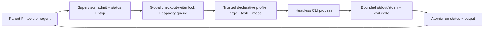
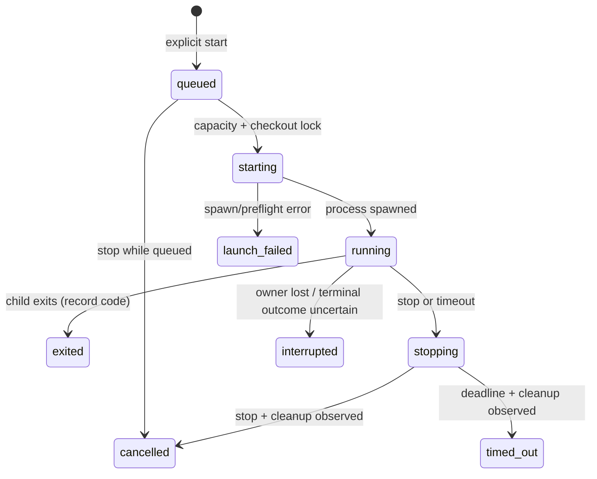

# Implementation plan: Pi Agent Supervisor

**Status:** M1–M4, the approved M5–M6 usability increment, user-controlled model selection, opt-in worktree isolation and human-directed inline RPC controls are implemented. Offline checks and explicitly approved real-Pi provider/terminal E2E checks passed; Codex/Claude model-backed behavior remains unverified. Historical M4 notes below retain their original offline-only scope. This is the canonical scope for the implementation. Work through milestones in dependency order; run a real fake-CLI end-to-end test at each milestone boundary.

## Coloured process-state indicators (approved)

The operator selected dot + text indicators for browser rows, the persistent widget and detail headings. Running/starting are blue, queued amber, stopping yellow, clean process exit 0 green, failed/nonzero/timed-out/interrupted outcomes red, and cancelled/unknown exits gray. Keep the readable state and exit code alongside the dot; green never means semantic task success. Use light/dark-aware colours and terminal colour-depth conversion, preserve state colouring on selected rows, and leave model-facing/plain output free of ANSI. No lifecycle changes or additional test-writing in this increment; run existing relevant checks and typecheck.

## Inline controls and interactive turns (approved)

The operator approved inline ←/→ actions, real steering/follow-up where supported, and a bordered opaque browser. This supersedes the earlier steering/session deferral only for explicit human actions, not inter-agent messaging or orchestration. Keep the three model-facing tools unchanged.

Implement a trusted `pi-rpc` task transport and whole-argument `{session}` slot, independent of executable names. Each turn retains existing process ownership, deadlines and checkout locks. Close RPC stdin only after `agent_settled`; do not treat `agent_end` as idle. A follow-up explicitly reopens the private saved session in a new tracked run, with the same model/settings and retained workspace; no idle child holds capacity or locks. Serialize conversation admission, verify reused worktree identity under its lock, and refuse uncertain/unsaved sessions. Keep historical turn records. Rerun is a fresh conversation/workspace from current committed HEAD, preserving resolved task/model/effort/isolation/timeout unless edited. Steer must fail, not silently become a follow-up, if completion races the editor.

The list uses ↑/↓ for rows, ←/→ for contextual actions, Enter to execute, and confirmed Stop/Cancel. Unsupported capabilities are absent. Native editors/settings dialogs are opened only after disposing the browser interaction. Paint every cell, including blank rows, inside a themed border. Verify protocol framing/correlation/settlement, continuation locking/retention, legacy profiles, UI navigation, resize, regular/fullscreen terminals and typecheck without paid provider calls. Do not reload or terminate existing user runs.

**Verification:** the installed Pi 1.5.0 completed real RPC steering and session reopening against an isolated loopback-only deterministic endpoint, proving original/steering/follow-up context reached subsequent requests without paid-provider calls. Fake RPC children cover settlement/ack ordering, rejection, timeout, retained dirty-worktree continuation, duplicate admission, fresh reruns and reload. Regular/fullscreen PTYs passed inline steering, follow-up, confirmed rerun and editing cancellation alongside existing model/worktree/lifecycle flows. The shipped and active user Pi profiles now select RPC; other profiles and model/effort choices were preserved. `PI_AGENT_SUPERVISOR_CLI_SMOKE=1 npm test` passed 112 with 2 opt-in provider cases skipped (114 total); typecheck passed. An existing zero-duration Git fixture was given a brief live interval because the parallel suite could otherwise exit before the durable PID-identity checkpoint; ownership safety was not relaxed. No current user run was reloaded or restarted.

**Commit verification correction:** the duplicate-follow-up race check now submits identical competing messages. Admission guarantees exactly one accepted continuation, not which caller wins asynchronous preflight; the previous fixture incorrectly assumed the first caller won. No production behavior or safety check was weakened. Before scoped commits, the full CLI-smoke suite passed 112 tests with 2 provider cases skipped, typecheck and runtime-only audit passed; the profile and lifecycle commits were also independently typechecked/tested from archived Git snapshots.

## Separate worktrees (approved 2026-11-12)

Supersedes the earlier prohibition on optional worktrees, not the no-orchestration contract. Add `isolation: "worktree"` to `agent_start` and `/agent run --isolation worktree`; omitted/`shared` keeps current serialized behavior. Each admitted isolated run gets a supervisor-generated private worktree path and `pi-agent/<run-id>` branch, pinned to the source checkout's committed HEAD at admission. Uncommitted/untracked source changes are **not** copied; surface this limitation in start results, notifications and detail views. Map a requested committed subdirectory into the new checkout, fail explicitly for non-Git/unborn/missing committed directories, and never fall back to the shared checkout.

Create worktrees only once a queued run is admitted to an active slot. Persist the generated identity/intent before Git side effects. Keep the existing per-checkout lock, keyed to each generated worktree rather than the source checkout, so isolated runs and shared writers can coexist under the existing concurrency bound. No engine-specific branches, automatic task fanout, review loops, dependency installs, commits or merges. Disable Git checkout hooks for extension-owned worktree creation.

Retain branches and worktrees after exit, cancellation, timeout, setup failure or crash recovery; never delete unfinished work automatically. Expose source, branch, base commit, path and workspace state in tools/TUI. Add a human-only confirmed `/agent worktree remove <id>` for a terminal owned run: verify generated path/branch and Git registration, acquire the workspace lock, refuse live/uncertain processes, and refuse tracked, untracked **or ignored** changes. Git removal uses no `--force`, leaves the branch intact, and is idempotent for already removed registered identities. Never offer model-facing destructive workspace cleanup.

Verification: real Git repositories and fake CLI tests prove overlapping same-repo isolated writers, shared-writer compatibility, source isolation, branch/HEAD/subdirectory correctness, queue cancellation before Git creation, admission failures, stop/timeout/shutdown/crash retention, safe cleanup (dirty/ignored/renamed/foreign worktrees and active locks refused), persisted/reloaded metadata, and real-Pi RPC plus terminal invocation. Existing non-worktree lifecycle tests and typecheck remain mandatory. Do not alter or restart existing runs, automatically reload the user's extension, or send paid provider tasks for this feature.

**Verification:** real Git 2.39.5 repositories (including paths with spaces) and actual fake CLI processes passed concurrency/source-isolation, pinned HEAD, subdirectory mapping, queued cancellation, setup-failure/no-fallback, hook suppression, cancellation during preparation, stop/timeout/shutdown/crash retention, dirty/ignored/foreign/active cleanup refusal, capacity and model-tool metadata checks. The installed Pi 1.5.0 RPC runtime ran simultaneous isolated jobs and confirmed clean removal while preserving branches/sibling worktrees. Regular/fullscreen PTY sessions passed parallel worktrees, branch/path visibility, stop retention and explicit clean cleanup alongside the existing settings/lifecycle checks. `PI_AGENT_SUPERVISOR_CLI_SMOKE=1 npm test` passed 102 tests with 2 opt-in live-provider tests skipped (104 total), typecheck and runtime-only audit passed, and no provider calls were made for this feature. Failed setups and interrupted/recovered runs deliberately refuse extension-managed cleanup as uncertain; manual inspection/Git cleanup is required. No existing user runs were changed or restarted. LSP defaults remain unavailable; compiler diagnostics are the verified gate.

## User-controlled model selection (approved 2026-11-10)

Supersedes the earlier profile-model-default/no-picker decisions for normal extension launches. Model precedence is explicit run override → user selection in `/agent settings` → the current parent session model, resolved afresh at launch. No model is pinned by shipped or active profiles. Model preferences live in a private user-level `settings.json` beneath the supervisor config directory, not project configuration. Clearing a preference restores parent-following. The TUI offers scoped/available models and an exact-ID entry for CLI-specific models; changes apply to subsequent launches, never running agents.

Keep CLI differences declarative: optional `modelArgs`/`effortArgs` groups expand at whole-argument `{modelArgs}`/`{effortArgs}` slots; `modelFormat` selects qualified provider/model or bare ID, and `parentProviders` limits compatible parent providers. No engine-name branches or guessed cross-provider aliases. Model maps on these new profiles describe verified effort capabilities rather than a frozen model allowlist. Unknown explicit efforts remain errors; omitted effort groups let the selected CLI use its own configuration. Legacy profile syntax remains readable, but the extension's parent/user selection takes precedence over legacy model defaults. Profiles without model-selection support retain their existing generic launcher behavior. Migrate shipped and active Pi/Codex/Claude profiles by removing pinned model/effort defaults while preserving exact supported effort maps and operational flags.

Verify precedence, parent model changes, incompatible providers, optional argv-group validation, persisted settings, explicit override, TUI save/clear/cancel, existing lifecycle tests and real terminal settings interaction. Real-provider tests remain opt-in and select the current user-chosen parent model rather than rely on a removed profile default. They use a verified low-effort override only when mapped, otherwise omit that optional argument; they never guess effort support for a newly selected model.

**Verification:** shipped and active user profiles were migrated to argument groups, with no pinned model/effort defaults; existing per-model effort capability maps and operational flags were preserved. `PI_AGENT_SUPERVISOR_CLI_SMOKE=1 npm test` passed 86 tests with 2 live cases skipped (88 total), and typecheck passed. The real parent/child test separately passed on the user's newly selected `openai-codex/gpt-6.1-sol`, which was not in the original Pi effort map: the child inherited that model, omitted unsupported effort configuration, wrote the expected artifact, and returned the clean answer. Regular/fullscreen PTY tests passed model-settings save, per-run override and clear-to-parent, alongside lifecycle/cleanup checks. Model-selection tests cover parent changes, precedence, scope/provider compatibility, unavailable-model failure, persistence, cancellation and argument-group safety. LSP defaults remain unavailable; compiler diagnostics are the verified gate.

## Authorized real-Pi E2E verification (2026-11-10)

The operator explicitly approved small real-provider tasks using existing credentials for **Pi only**. Tests use private temporary configs/workspaces and copies of existing credentials; credential contents are never printed, and original user settings/profiles are not rewritten. The existing exact model `openai-codex/gpt-6-luna` and its verified `minimal` effort mapping were used. At test time the user-level Pi profile omitted `outputProtocol`; isolated test profiles explicitly selected `pi-jsonl` rather than silently changing user configuration. On the subsequent explicit "fix it all" request, the active user-level Pi profile was migrated to `outputProtocol: "pi-jsonl"`. Its existing model/effort defaults and all other profiles were preserved. The actual trusted config and resolved launch recipe were validated; typecheck and the ordinary suite passed (73 passed, 4 opt-in cases skipped), without additional provider calls. Package installation settings were not changed.

Verified beyond fake-process/unit coverage:

- `PI_AGENT_SUPERVISOR_LIVE_PI=1 npx tsx --test test/live-pi.test.ts`: a real parent model calls `agent_start` exactly once, the child actually reads a seed file and writes the expected `34\n` artifact, final-answer extraction returns exactly `LIVE_CHILD_OK`, the real parent retrieves it via `agent_get` without raw protocol/transcript leakage, and completion does not trigger an unsolicited parent turn. The owned child process group is gone. Outcome assertions check the artifact and answer, not just exit 0.
- `PI_AGENT_SUPERVISOR_LIVE_PI=1 npx tsx --test test/live-pi-control.test.ts`: a real Pi child actually starts a bash tool and sleeping descendant. RPC-confirmed stop removes the Pi group and both tool PIDs. A second real child times out at 20 seconds; its bash tool had started, and both tool PIDs and the Pi group are gone. Neither cancellation nor timeout publishes a final answer.
- `python3 test/fixtures/tui-smoke.py --live`: regular and fullscreen real terminals both render a real Pi child's exact `LIVE_TUI_OK` answer and readable transcript, with resize/close checked. The same sessions use fake children for deterministic queue/confirmation/queued-stop/running-stop/timeout/invalid-profile/reload/quit cleanup checks.
- Expanded no-provider `python3 test/fixtures/tui-smoke.py`: both modes additionally assert that loading alone creates no work, the empty browser is usable, and raw diagnostics can be loaded explicitly; raw reasoning/stderr never appears before diagnostic inspection.
- `PI_AGENT_SUPERVISOR_CLI_SMOKE=1 npm test`: 75 passed, 2 live-provider cases skipped (77 total). Both skipped cases were run separately with approval and passed. Offline Pi/Codex model/effort catalogs and Claude help checks passed without provider tasks. `npm run typecheck`, runtime-only audit, and whitespace checks passed. No leftover test child processes were observed. Default LSP servers remain unavailable; compiler diagnostics are the verified gate.

All currently implemented Pi flows above are exercised; this is not a claim about unsupported steering/resume/nesting or live Codex/Claude behavior. Full dev-dependency audit remains as recorded below.

## Usability increment (approved 2026-11-10)

Implement M5 then M6 without changing the one-explicit-task contract:

- **M5 — presentation and recovery:** investigate the recovery-test synchronization failure; add trusted profile-selected output protocols (`raw` fallback, `text`, `pi-jsonl`), incremental bounded parsing, separate stdout/stderr diagnostics, a bounded readable transcript and extracted final answer. Protocol data never determines process state or semantic success. Add labels and explicit root-session parentage; no claimed grandchildren. `agent_get` defaults to clean status/answer; raw output is opt-in. Existing records and profiles remain readable. Completion notifications include a bounded answer preview but never start parent turns.
- **M6 — live TUI:** supervisor subscriptions and log-free snapshots feed a height/width-bounded persistent widget and live `/agent` browser. Support selection stability, detail/answer, scrollable transcript, diagnostics on demand, and confirmed stop. Show queue reasons. Use Pi components/theme/keybindings; dispose subscriptions/timers on close/shutdown/reload; no TUI calls outside TUI mode.
- **Deferred:** interactive sessions/steering/resume and nested delegation. These require a separate approved contract and lock/workspace design; no messaging, workflow engine, automatic reviews, role pipeline, or new background model turns in this increment.
- **Verification:** fake CLI noisy-output E2E, protocol fragmentation/malformed/oversized records, independent diagnostic bounds, persisted results, current-session tree/queue display, component navigation/resize/Unicode/theme/cleanup tests, installed-Pi RPC smoke, full tests and typecheck. No paid provider call or automatic reinstall into user settings.

**M5–M6 verification:** `npm test` passed 73 tests with 2 opt-in CLI catalog/help checks skipped (75 total); `npm run typecheck`, `git diff --check`, and `npm audit --omit=dev` passed. The installed Pi 1.5.0 RPC runtime loaded the extension and exercised real fake-agent commands. `python3 test/fixtures/tui-smoke.py` passed in regular and fullscreen modes, exercising the widget, live browser, answer, transcript, resize and close through a PTY. No model/provider prompt was sent. No user package settings or trusted profiles were changed/reinstalled. Full development-dependency audit still reports four findings (2 moderate, 2 high) in the existing Pi 1.0.0 dev dependency tree; the runtime-only audit is clean. LSP diagnostics reported unavailable default servers; TypeScript compiler checking is the verified diagnostic gate.

**Corrections discovered during the increment:** the recovery fixture observed mutable `running` state before its PID checkpoint was persisted; it now waits for durable PID/start identity before killing the owner. Terminal `get()` waits for terminal persistence/notification. A new fake-CLI test exposed shutdown racing checkout acquisition; teardown now drains admission and the pump before cancelling jobs. The real TUI smoke exposed `/agent run` passing `{task, options}` rather than forwarding parsed options; labels, model, effort, cwd, profile and timeout flags are now forwarded correctly, with regression assertions. These corrections preserve the safety contract rather than loosening checkout serialization.

The old compact picker and JSON pretty-preview are superseded by M5–M6. The launch/safety invariants below remain unchanged. Protocols are selected in trusted profile data, never inferred from executable names. Initial structured parsing covers Pi JSONL only; other CLI JSON formats remain available as diagnostics until separately supported. Plain text extraction requires explicit `outputProtocol: "text"`.

## Outcome and decisions

Build a small Pi extension that starts **one explicitly requested headless coding agent per call**, returns a run ID promptly, captures its output and process outcome, and permits inspection or reliable cancellation. Agents may edit by default. Multiple explicit starts are allowed, bounded by capacity; supervised writers in one checkout are serialized.

- **Agent-agnostic:** executable/argv/task transport/model selection are trusted, declarative launch-profile configuration. Ship Pi, Codex, and Claude Code profiles; a third fake executable must work without branching on its name in supervisor code.
- **Model and effort choice:** profiles configure a default model and, when support is verified for the selected CLI/provider, a default reasoning effort (for example, `max`). `model: "gpt-5.6-sol"` and `effort: "high"` are independent optional overrides. Pass the selected model ID through unchanged and resolve effort through profile/model configuration; effort is not a universal enum. Reject unsupported overrides rather than silently falling back. If a profile omits effort mappings, let that CLI use its own default and reject explicit effort overrides. No model/effort picker.
- **Process facts, not quality claims:** a run can be `exited` with `exitCode: 0`, but the extension must not claim its coding task was correct. Capture generic stdout/stderr; JSONL formatting is optional presentation, never a prerequisite for lifecycle correctness.
- **One interface:** model tools `agent_start`, `agent_get`, `agent_stop`; human `/agent` command with `run`, `list`, `show`, `stop`, `profiles`. `/agent` alone opens a compact picker. `--model`, `--effort` and `--profile` are optional flags, not interactive selection steps.
- **Explicit non-goals:** no automatic task creation/fanout, role or review workflow, inter-agent channel, webhook, steering, recursive agent calls, default worktrees, Herdr, or Whiteboard integration.
- **Trusted config location:** profiles live at `agent-supervisor/profiles.json` below Pi's config root (`PI_CODING_AGENT_DIR` when set, otherwise `~/.pi/agent`); private run metadata/logs live below its `runtime/` directory. The global checkout-lock directory is `~/.pi/agent/agent-supervisor/locks`, independent of a custom config root. Supervisor directories are created with mode `0700`; run records/logs are mode `0600`. Do not load profiles from the project checkout or from task/tool arguments.
- **M2 platform boundary:** verified process-tree termination currently requires POSIX process groups. Windows is rejected at initialization rather than starting children whose descendants cannot be reliably cleaned up.
- **M1 profile format:** one strict JSON object with `defaultProfile` and a `profiles` map. Each profile declares `executable`, `args`, and `taskTransport`; optional model maps are keyed by exact CLI model IDs, which are passed through unchanged, while effort aliases map independently to CLI-specific values. `{task}` must occupy one whole argv element; each `{model}`/`{effort}` placeholder may occur once, including embedded in a literal argv value such as Codex's `model_reasoning_effort="{effort}"`. Placeholders are substituted in an argv array with `shell: false`, and shell expansion syntax is rejected.



## Preflight for the implementation agent

1. Work in this Git repository. Read `README.md`, `AGENTS.md`, and this document; inspect `git status` before writing code. No existing implementation is assumed.
2. Verify the *installed* Pi, Codex, and Claude Code versions, their CLI help, and confirm JSON/one-shot behavior and actual model syntax. At planning time, the installed CLIs reported Pi `1.0.0`, Codex CLI `0.154.0`, and Claude Code `2.1.175`; these can change.
3. Inspect the current Pi extension and TUI contracts, particularly `docs/extensions.md`, `docs/tui.md`, `docs/packages.md`, and the tool/command examples under `/opt/homebrew/lib/node_modules/@earendil-works/pi-coding-agent/`. Verify current TypeScript APIs before using them. The Pi extension factory must not start processes; use session/command/tool lifecycle, and release resources idempotently on `session_shutdown`.
4. Verify Luna/Sol model IDs, supported reasoning-effort values, defaults and credential availability **for each profile/model combination**. The installed Pi CLI advertises `--thinking <level>`; installed Codex supports `-c key=value`, and the current local Codex config uses `model_reasoning_effort = "max"`. Verify their exact behavior at implementation time. Do not run a paid model call merely to enumerate flags; leave sample model mappings as placeholders until confirmed by the operator.
5. Decide where the trusted user-level profile config and private runtime directory live; document and test the location. Do not load arbitrary launch commands from an untrusted task or model tool argument.

Reference evidence (patterns, not code to import): installed `pi-subagents` async status/process ownership paths under `~/.pi/agent/npm/node_modules/pi-subagents/src/runs/`; Pi's `docs/json.md` explains event framing and `agent_settled` if a future presentation parser is added. Generic lifecycle **must not** depend on those vendor events.

**Implementation preflight recorded for M1:** Pi `1.0.0` advertises `--mode json`, `--model`, and thinking levels through `max`; Codex CLI `0.154.0` documents `exec --json`, `--model`, `--config key=value`, and `-` for task stdin. At that point no production model IDs were published. M4 catalog and no-task verification is recorded below; no paid model call was made, and auth/service availability remain unverified.

**M2 end-to-end evidence:** the fake executable has been spawned as a real child process and tests cover stdin/argv, exit codes, spawn failure, bounded output, queue admission/cancellation, timeouts, descendant cleanup after stop and natural exit, separate-OS-process checkout contention, stale PID/lock handling, and recovery after killing the supervisor process. `npm test` and `npm run typecheck` passed at the M2 boundary. No fake-agent or driver processes remained afterward.

**M3 end-to-end evidence:** the installed Pi `1.0.0` RPC runtime loaded `src/index.ts` through `--extension` with a trusted temporary fake-agent profile. The live test exercised `/agent run` and `/agent show`, received start and terminal notifications, inspected captured child output, and verified that process exit 0 is not described as task correctness. No model/provider call was made. The full `npm test` suite (33 tests), `npm run typecheck`, `git diff --check`, and `npm audit --omit=dev` passed at this boundary.

**M4 offline CLI evidence:** verified installed Pi `1.0.0` model IDs `openai-codex/gpt-6-luna` and `openai-codex/gpt-6-sol` using `pi --list-models` and no-task RPC `get_state` with selected thinking levels. Verified installed Codex CLI `0.154.0` IDs `gpt-5.6-luna` and `gpt-5.6-sol`, `supported_in_api`, and per-model reasoning levels through `codex debug models`; a `-c model_reasoning_effort="max"` catalog invocation returned successfully. `PI_AGENT_SUPERVISOR_CLI_SMOKE=1 npx tsx --test test/cli-profile-smoke.test.ts` passed. These checks submit no task and establish neither authentication nor provider/service availability; no paid model call was attempted. Final verification with `PI_AGENT_SUPERVISOR_CLI_SMOKE=1 npm test` passed 38/38 tests, and `npm run typecheck`, `git diff --check`, and `npm audit` passed.

**2026-10-06 profile update:** Added a `claude-code` sample and installed user profile, using Claude Code `2.1.175`'s verified `--print`, stdin, JSON-output, and no-session-persistence options, passing the documented `sonnet`/`opus` CLI selectors through unchanged. Its effort is intentionally unset: Claude's effective effort support depends on the selected provider/model, so exposing guessed values risks CLI-side clamping. `--permission-mode acceptEdits` allows edits without bypassing the user's permission policy; shell/network permissions remain user-configured. The official Pi, Codex, and Claude Code documentation cross-check and local CLI evidence are recorded in `docs/configuration.md`. A no-task Claude help smoke check passed; no provider prompt was sent.

**2026-10-06 model-ID simplification:** `models` keys and `defaultModel` now hold exact CLI model IDs/selectors, and the supervisor passes the selected string through unchanged; per-entry `id` fields and model alias-to-ID translation are removed. Per-model effort capability/default data remains for pre-launch validation. Runtime model-catalog discovery is not added here because each CLI exposes its catalog differently; such discovery would need a separate, declarative capability rather than engine-specific supervisor branches. The direct-ID update passed the offline catalog smoke tests, all 39 tests, TypeScript typecheck, and `git diff --check`; the trusted user profile was updated to the new format.

## Contract to implement

Illustrative public types (refine exact Pi tool schemas during M1 without expanding scope):

```ts
type StartInput = {
  task: string;
  model?: string;       // exact CLI model ID, e.g. "gpt-5.6-sol"; absent = profile default
  effort?: string;      // configured effort alias, e.g. "high"; absent = model/profile default
  profile?: string;     // absent = configured default profile
  cwd?: string;         // absent = parent cwd
  timeoutMs?: number;
};
type RunState =
  | "queued" | "starting" | "running" | "stopping"
  | "exited" | "launch_failed" | "cancelled" | "timed_out" | "interrupted";
type Run = {
  id: string; profile: string; model?: string; effort?: string; cwd: string;
  state: RunState; createdAt: string; startedAt?: string; endedAt?: string;
  exitCode?: number; error?: { code: string; message: string };
  outputTail?: string; logPath?: string;
};
agent_start(input: StartInput): Promise<{ id: string; state: RunState }>;
agent_get(input: { id?: string }): Promise<Run | { runs: Run[] }>;
agent_stop(input: { id: string }): Promise<{ id: string; state: RunState }>;
```

- Validate nonempty task, known profile/model ID, allowed cwd, finite positive timeout, and queue capacity **before** admitting a job. Generate IDs on the supervisor side. Bound tool responses and list length.
- Profiles define executable, static argv with strictly validated placeholders, task transport (`stdin` or one argv element), optional environment, default model ID and supported/default effort per model ID. Map effort to arguments through trusted profile data (e.g. Pi `--thinking <level>`; Codex's verified `model_reasoning_effort` config override), never engine-name branches. Resolve executable and argv directly with `spawn` (no shell). Do not treat a model-provided `profile` as an executable path. Prefer stdin when the CLI supports it; argument transport may expose task text in the OS process list. Avoid putting credentials in argv or run logs.
- Unknown or unsupported explicit model **or effort** selection is an error, never a fallback. When `effort` is omitted, use the selected model ID's configured default, then the profile default; do not inherit the parent Pi session's effort by accident. Ensure a profile can launch without model-specific code in the supervisor. If a profile is incompatible with a requested optional capability, reject it explicitly.

**Verified CLI argument mappings (installed Pi 1.0.0, Codex 0.154.0, and Claude Code 2.1.175):** the generic launcher resolves `{model}`/`{effort}` from the chosen trusted profile, then substitutes validated values into an argv array. These are sample profile data, not `if (engine)` branches:

```text
Pi:     pi --no-extensions --no-session --mode json --print --model <model-id> --thinking <resolved-effort> -- <task>
Codex:  codex exec --json --model <model-id> --config 'model_reasoning_effort="<resolved-effort>"' --ephemeral -
        (Codex task is written to stdin; quotes above are part of one argv value, not a shell command)
Claude: claude --print --no-session-persistence --model <CLI selector> --permission-mode acceptEdits --output-format json
        (Claude task is written to stdin; no effort override is configured because support varies by provider/model)
```

Pi `--help` lists `--thinking` levels `off`, `minimal`, `low`, `medium`, `high`, `xhigh`, `max`; Pi may clamp a level to a model's capability, so validate against the selected model ID/profile before launch where possible. Codex `exec --help` documents `--config key=value` overrides and `--model`; the current local Codex config uses `model_reasoning_effort = "max"`. Verify supported effort values per installed Codex model; do not assume the two CLIs support identical levels. The M4 profile therefore uses the generic embedded `{effort}` substitution to form the literal argv value `model_reasoning_effort="max"`; this changes the M1 placeholder rule only for model/effort values. `{task}` remains a whole argument or stdin-only, and substitution never invokes a shell. Profile contents remain trusted user configuration; no config key is accepted from a task/tool argument.

- Status represents the process, not the work product: zero exit maps to `exited` with `exitCode: 0`, nonzero exit maps to `exited` with that code and an error summary. Launch failure is separate; cancellation and timeout require observing cleanup. No generic `succeeded` state.
- Scope runs to the owning Pi session in v1. Stop owned live children on session shutdown/reload; after a crash, reconcile status and process identity, never silently restart. If termination cannot be established, record `interrupted`/uncertainty rather than an invented success.

### State and ownership



Canonicalize checkout identity via real path and Git worktree root where available; fall back to canonical cwd outside Git. The writer lock must arbitrate across **multiple supervisor instances**, not just one process. Hold it from launch admission through terminal cleanup, and recover stale locks only after verifying owner/process identity. This lock cannot prevent the parent Pi or unrelated processes from editing the same files; document that limit. No automatic worktree or merge.

## Milestones (one writer, sequential)

| ID | Depends on | Deliverable | Likely files | Verification gate |
|---|---|---|---|---|
| M1 | — | Package setup, strict config/profile validation, exact model-ID selection, effort alias resolution, and argv construction; test with fake profiles before real CLIs | `package.json`, `src/config.ts`, `src/profiles.ts`, `test/profiles.test.ts` | Tests reject unknown model/effort/profile, shell interpolation, ambiguous task placeholder and unsupported transport. |
| M2 | M1 | Run registry, state transitions, bounded output, queue, cross-process checkout writer lock, spawn/stop/timeout/process-tree cleanup and crash reconciliation | `src/run-store.ts`, `src/checkout-lock.ts`, `src/process.ts`, `src/supervisor.ts`, `test/supervisor.test.ts`, `test/fixtures/fake-agent.*` | Real spawned fake-CLI tests cover ordinary/nonzero exit, queued and running stop, timeout, output flood, descendant cleanup, separate-process concurrent writers, stale PID/lock, and restart. |
| M3 | M2 | Pi extension tools and `/agent` commands; compact picker/detail using Pi UI only in interactive mode | `src/index.ts`, `src/tools.ts`, `src/commands.ts`, `src/ui.ts`, `test/extension.test.ts` | Tool schemas/result types, command parsing, no-UI modes, fast start, bounded list/detail, confirmation before manual stop, and completion notification. |
| M4 | M3 | Verified Pi, Codex, and Claude Code sample profiles, installation docs, no-task CLI smoke test and fake third CLI E2E | `profiles/verified.json`, `README.md`, `docs/configuration.md`, `test/cli-profile-smoke.test.ts`, `test/pi-rpc.test.ts` | New fake profile runs with **no supervisor code change**; offline profile/model/effort selection passes for installed CLIs without a provider prompt. Actual provider task response/exit behavior remains an opt-in verification requiring explicit cost/auth approval. |

Treat paths as a suggested file map, not a mandate to create empty modules. Keep the implementation small; prefer merging tiny modules over adding framework layers. Use a test runner and typecheck in `package.json` once dependencies are chosen; include their lockfile. Pi host-provided packages belong in `peerDependencies`, not bundled runtime dependencies (see Pi `docs/packages.md`). Declare the Pi extension entry in the package manifest only when that file exists.

### M1 details — config and process recipe

- Build one loader/schema for trusted profile definitions and defaults. Select exact model IDs from the trusted profile map and pass them through unchanged; resolve effort aliases independently because effort defaults may vary by model. Keep effort CLI mapping in profile data, not `if (profile === "pi")` branches. Persist and display the effective model and effort on each run.
- Pin down task injection rules, including prompts beginning with `-`, whitespace, quotes, and Unicode. An argument placeholder must occupy a whole argv element and be used exactly once when task transport is `argument`; stdin transport should not duplicate the task on argv.
- Validate executable availability before enqueue or transition cleanly to `launch_failed`. Profiles must not use shell wrappers solely to interpolate tasks. If CLI flags for Pi, Codex, or Claude Code differ, express the difference in profile data.

### M2 details — safety and lifecycle

- Use durable per-run metadata (atomic status file), private bounded logs and a process-instance token/start identity so a stale PID cannot be killed by mistake. Read stdout and stderr continuously to avoid blocking a child on full pipes. Keep log bounds independently of model-facing tail bounds.
- Implement a finite queue and active limit with admission serialized against parallel tool calls. A queued run cancelled before launch must never spawn. Cover concurrent processes contending for the same checkout lock.
- On explicit stop or timeout: transition to `stopping`, attempt graceful shutdown, escalate to process-tree termination, and persist whether cleanup was observed. Avoid sending signals to processes unless ownership is verified. Make stop and shutdown idempotent.
- On restart/reload: reconcile previous records and still-live owned children conservatively; never resurrect a job automatically. Track terminal notifications to prevent duplicate announcements.

### M3 details — Pi integration and interaction

- Register three tools with small, accurate descriptions: no suggestion to manufacture parallel jobs or run review passes. A start response reports ID/state; full output is retrieved on demand.
- Register one `/agent` command with subcommands `run`, `list`, `show`, `stop`, `profiles`; bare `/agent` opens a small interactive list. `run` uses defaults and immediately starts, with optional `--model`, `--effort` and `--profile`. Do not implement a model/effort/agent-selection dialog.
- Interactive list: profile/model/effort, task excerpt, elapsed time and process state. Detail: task, cwd, bounded output and exit code. Use Pi TUI helpers and handle terminal resize/narrow widths. In JSON/RPC/print modes tools continue to work; skip custom TUI and avoid depending on UI confirmation where none exists. Manual interactive stop asks for confirmation; programmatic stop follows tool authority.
- Notify once when a run terminates while the owning Pi session is available. A notification is not a model instruction or an automatic next turn. After exit, `agent_get` remains authoritative.

### M4 details — integration and docs

- Verify actual Pi, Codex, and Claude Code help/auth/model/effort flags at implementation time. A Pi JSONL parser may provide a nicer view later, but a process running Pi is still governed by generic exit/stop logic. Avoid loading the supervisor extension recursively in child Pi processes; validate any resource-disabling flags against required model/provider configuration.
- Document local installation (`pi install .`), where profiles reside, how to set default model IDs and effort mappings, output retention, checkout-lock scope and trusted-configuration security. Include a copyable third-profile example.
- Test launch and cancellation with a fake CLI in CI. Offline Pi/Codex model-catalog and Claude Code help smoke checks must not submit a task; real provider prompt tests require explicit cost/auth approval.

## Release blockers (acceptance)

The offline suite and fake-agent lifecycle tests cover these code-level acceptance checks. They do not verify provider authentication, paid task responses, or semantic task correctness.

- [x] A normal job can edit in its checkout; no blanket read-only default.
- [x] Configured model and supported effort defaults are used without prompting (e.g. Luna with `max`); explicit model-ID and supported effort overrides resolve independently to intended CLI arguments; unknown or unsupported selections fail clearly. Profiles without verified effort mappings use their CLI's default and reject explicit effort overrides.
- [x] Pi, Codex, Claude Code, and a third fake headless CLI use the **same** generic launcher and lifecycle, with no per-CLI supervisor branch.
- [x] A start returns an ID promptly; list/detail show truthful queued, active and terminal states plus bounded captured output.
- [x] Two supervised writers in one canonical checkout cannot overlap, including across separate Pi processes; writers in separate checkouts may run concurrently.
- [x] Queued stop, live stop, timeout, exit-code failure, launch failure, output flood, stale PID/lock and supervisor restart have tests.
- [x] Stop/timeout does not report terminal cleanup before it is observed; no silent retries or orphaned owned child processes in normal shutdown.
- [x] The three tools and `/agent` commands work without Herdr or Whiteboard; there is no inter-agent communication, review-specific API or automatic fanout.
- [x] `npm test` and typecheck (scripts established in M1) pass; smoke checks and remaining risks are recorded before marking done.

## Risks and boundaries

- **Generic outcome is limited:** not all CLIs expose a machine-readable final answer. Show output and exit code without pretending to know if the task was completed correctly.
- **Model and effort availability are profile-specific:** model IDs/selectors are CLI/provider-specific, not portable names, and effort support is model-dependent. Preflight exact IDs, allowed levels and auth; do not hardcode unverified mappings.
- **Profiles are trusted executable configuration:** loading profile definitions from untrusted project content or interpolating shell commands would expand the attack surface. Do not do either by default.
- **Checkout locks cannot control outside writers:** they coordinate only supervisor-managed jobs. Warn when the parent may edit concurrently.
- **Long-lived processes:** session shutdown/reload and process-tree ownership are correctness-critical; test them before UI polish.

## Post-implementation boundary

M1–M4 code, documentation, fake-agent lifecycle coverage, Pi RPC integration, and offline CLI catalog/help verification are complete. The sample set now includes Claude Code, with provider-specific effort left unset until the operator verifies a model/provider combination. At the M4 boundary real provider prompt tests were intentionally unrun pending explicit authentication/cost approval. The later Pi-only approval and verification are recorded above; Codex and Claude Code provider tasks remain unrun. Never infer semantic task correctness from exit status.

**2026-10-06 review corrections:** Reproduced and fixed stale-lock recovery races by serializing lock acquisition/recovery/update/release with a persistent per-checkout SQLite guard (`node:sqlite`; Node >=22.19.0). Added same-process and multi-process concurrent stale-recovery tests, plus guard-owner crash recovery. Child stdin `EPIPE` is now captured as a run-level `STDIN_IO` failure and never escapes as an unhandled parent-process error; a real early-exit child test covers it. The shipped Codex profile default and allowlist now agree (`gpt-6-luna`, with `gpt-6.1-sol` as the Sol option); the current installed Codex CLI 0.160.1 local catalog was checked without a task request. The extension now aliases Pi's exported API types instead of maintaining a local API mirror. JSON/JSONL output receives a bounded presentation-only pretty preview; raw captured logs and lifecycle decisions are unchanged. Verification: `PI_AGENT_SUPERVISOR_CLI_SMOKE=1 npm test` passed 45/45 tests, `npm run typecheck`, `git diff --check`, and `npm audit --omit=dev` passed; no provider prompt was sent. Full `npm audit` still reports a high-severity `brace-expansion@5.0.9` advisory inside the dev-only Pi 1.0.0 npm-shrinkwrap; npm's suggested fix does not update that shrinkwrapped dependency.
