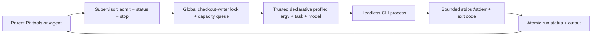
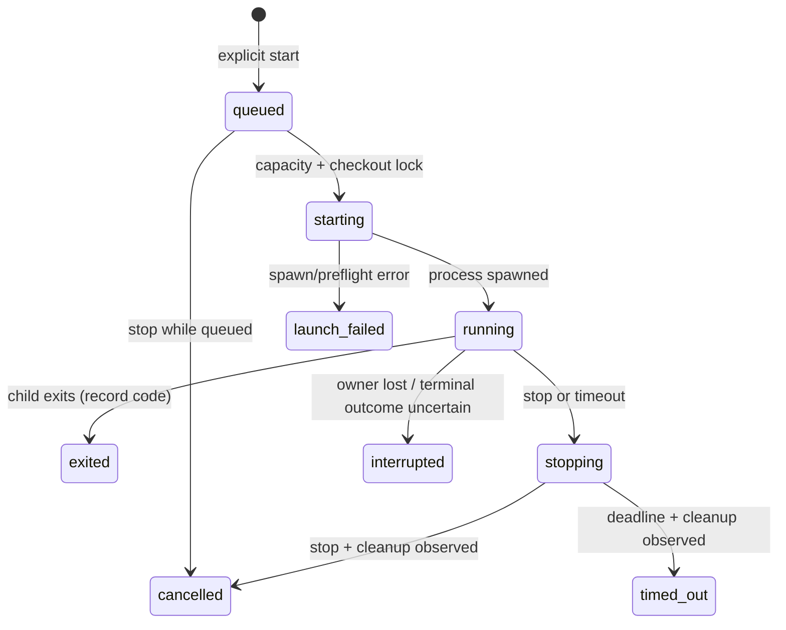

# Implementation plan: Pi Agent Supervisor

**Status:** Target. No supervisor code exists yet. This is the canonical scope for the first implementation session. Work through milestones in dependency order; do not implement every item in one unverified edit.

## Outcome and decisions

Build a small Pi extension that starts **one explicitly requested headless coding agent per call**, returns a run ID promptly, captures its output and process outcome, and permits inspection or reliable cancellation. Agents may edit by default. Multiple explicit starts are allowed, bounded by capacity; supervised writers in one checkout are serialized.

- **Agent-agnostic:** executable/argv/task transport/model selection are trusted, declarative launch-profile configuration. Ship Pi and Codex profiles; a third fake executable must work without branching on its name in supervisor code.
- **Model and effort choice:** each profile has a configured default model (expected Luna for the usual profile) and default reasoning effort (for example, `max`). `model: "sol"` and `effort: "high"` are independent optional overrides. Resolve both through profile/model configuration to actual CLI values; effort is not a universal enum. Reject unsupported overrides rather than silently falling back. No model/effort picker.
- **Process facts, not quality claims:** a run can be `exited` with `exitCode: 0`, but the extension must not claim its coding task was correct. Capture generic stdout/stderr; JSONL formatting is optional presentation, never a prerequisite for lifecycle correctness.
- **One interface:** model tools `agent_start`, `agent_get`, `agent_stop`; human `/agent` command with `run`, `list`, `show`, `stop`, `profiles`. `/agent` alone opens a compact picker. `--model`, `--effort` and `--profile` are optional flags, not interactive selection steps.
- **Explicit non-goals:** no automatic task creation/fanout, role or review workflow, inter-agent channel, webhook, steering, recursive agent calls, default worktrees, Herdr, or Whiteboard integration.



## Preflight for the implementation agent

1. Work in this Git repository. Read `README.md`, `AGENTS.md`, and this document; inspect `git status` before writing code. No existing implementation is assumed.
2. Verify the *installed* Pi and Codex versions, `pi --help`, and `codex exec --help`; confirm JSON/one-shot behavior and actual model syntax. At planning time, the installed CLIs reported Pi `1.0.0` (`--mode json`, `--model`, `--no-extensions`) and Codex CLI `0.154.0` (`exec --json`, `--model`), but these can change.
3. Inspect the current Pi extension and TUI contracts, particularly `docs/extensions.md`, `docs/tui.md`, `docs/packages.md`, and the tool/command examples under `/opt/homebrew/lib/node_modules/@earendil-works/pi-coding-agent/`. Verify current TypeScript APIs before using them. The Pi extension factory must not start processes; use session/command/tool lifecycle, and release resources idempotently on `session_shutdown`.
4. Verify Luna/Sol model IDs, supported reasoning-effort values, defaults and credential availability **for each profile/model combination**. The installed Pi CLI advertises `--thinking <level>`; installed Codex supports `-c key=value`, and the current local Codex config uses `model_reasoning_effort = "max"`. Verify their exact behavior at implementation time. Do not run a paid model call merely to enumerate flags; leave sample model mappings as placeholders until confirmed by the operator.
5. Decide where the trusted user-level profile config and private runtime directory live; document and test the location. Do not load arbitrary launch commands from an untrusted task or model tool argument.

Reference evidence (patterns, not code to import): installed `pi-subagents` async status/process ownership paths under `~/.pi/agent/npm/node_modules/pi-subagents/src/runs/`; Pi's `docs/json.md` explains event framing and `agent_settled` if a future presentation parser is added. Generic lifecycle **must not** depend on those vendor events.

## Contract to implement

Illustrative public types (refine exact Pi tool schemas during M1 without expanding scope):

```ts
type StartInput = {
  task: string;
  model?: string;       // configured alias, e.g. "sol"; absent = profile default
  effort?: string;      // configured alias, e.g. "high"; absent = model/profile default
  profile?: string;     // absent = configured default profile
  cwd?: string;         // absent = parent cwd
  timeoutMs?: number;
};
type RunState =
  | "queued" | "starting" | "running" | "stopping"
  | "exited" | "launch_failed" | "cancelled" | "timed_out" | "interrupted";
type Run = {
  id: string; profile: string; model?: string; effort?: string; cwd: string;
  state: RunState; createdAt: string; startedAt?: string; endedAt?: string;
  exitCode?: number; error?: { code: string; message: string };
  outputTail?: string; logPath?: string;
};
agent_start(input: StartInput): Promise<{ id: string; state: RunState }>;
agent_get(input: { id?: string }): Promise<Run | { runs: Run[] }>;
agent_stop(input: { id: string }): Promise<{ id: string; state: RunState }>;
```

- Validate nonempty task, known profile/model alias, allowed cwd, finite positive timeout, and queue capacity **before** admitting a job. Generate IDs on the supervisor side. Bound tool responses and list length.
- Profiles define executable, static argv with strictly validated placeholders, task transport (`stdin` or one argv element), optional environment, default model, model-alias mappings, and supported/default effort per profile or model. Map effort to arguments through trusted profile data (e.g. Pi `--thinking <level>`; Codex's verified `model_reasoning_effort` config override), never engine-name branches. Resolve executable and argv directly with `spawn` (no shell). Do not treat a model-provided `profile` as an executable path. Prefer stdin when the CLI supports it; argument transport may expose task text in the OS process list. Avoid putting credentials in argv or run logs.
- Unknown or unsupported explicit model **or effort** selection is an error, never a fallback. When `effort` is omitted, use that model's configured default, then the profile default; do not inherit the parent Pi session's effort by accident. Ensure a profile can launch without model-specific code in the supervisor. If a profile is incompatible with a requested optional capability, reject it explicitly.

**Verified CLI argument mappings (installed Pi 1.0.0 and Codex 0.154.0):** the generic launcher resolves `{model}`/`{effort}` from the chosen trusted profile, then substitutes validated values into an argv array. These are sample profile data, not `if (engine)` branches:

```text
Pi:     pi --mode json --model <resolved-id> --thinking <resolved-level> -- <task>
Codex:  codex exec --json --model <resolved-id> --config 'model_reasoning_effort="<resolved-level>"' -
        (Codex task is written to stdin; quotes above are part of one argv value, not a shell command)
```

Pi `--help` lists `--thinking` levels `off`, `minimal`, `low`, `medium`, `high`, `xhigh`, `max`; Pi may clamp a level to a model's capability, so validate against the selected model/profile before launch where possible. Codex `exec --help` documents `--config key=value` overrides and `--model`; the current local Codex config uses `model_reasoning_effort = "max"`. Verify supported effort values per installed Codex model; do not assume the two CLIs support identical levels. Profile templates must allow a trusted config value such as `model_reasoning_effort="{effort}"` as one argv element while still forbidding shell interpolation and arbitrary untrusted config keys.

- Status represents the process, not the work product: zero exit maps to `exited` with `exitCode: 0`, nonzero exit maps to `exited` with that code and an error summary. Launch failure is separate; cancellation and timeout require observing cleanup. No generic `succeeded` state.
- Scope runs to the owning Pi session in v1. Stop owned live children on session shutdown/reload; after a crash, reconcile status and process identity, never silently restart. If termination cannot be established, record `interrupted`/uncertainty rather than an invented success.

### State and ownership



Canonicalize checkout identity via real path and Git worktree root where available; fall back to canonical cwd outside Git. The writer lock must arbitrate across **multiple supervisor instances**, not just one process. Hold it from launch admission through terminal cleanup, and recover stale locks only after verifying owner/process identity. This lock cannot prevent the parent Pi or unrelated processes from editing the same files; document that limit. No automatic worktree or merge.

## Milestones (one writer, sequential)

| ID | Depends on | Deliverable | Likely files | Verification gate |
|---|---|---|---|---|
| M1 | — | Package setup, strict config/profile validation, model and effort alias resolution, and argv construction; test with fake profiles before real CLIs | `package.json`, `src/config.ts`, `src/profiles.ts`, `test/profiles.test.ts` | Tests reject unknown model/effort/profile, shell interpolation, ambiguous task placeholder and unsupported transport. |
| M2 | M1 | Run registry, state transitions, bounded output, queue, cross-process checkout writer lock, spawn/stop/timeout/process-tree cleanup and crash reconciliation | `src/run-store.ts`, `src/checkout-lock.ts`, `src/process.ts`, `src/supervisor.ts`, `test/supervisor.test.ts`, `test/fixtures/fake-agent.*` | Fake CLI tests cover ordinary/nonzero exit, queued and running stop, timeout, output flood, descendant cleanup, concurrent writers, stale PID/lock, and restart. |
| M3 | M2 | Pi extension tools and `/agent` commands; compact picker/detail using Pi UI only in interactive mode | `src/index.ts`, `src/tools.ts`, `src/commands.ts`, `src/ui.ts`, `test/extension.test.ts` | Tool schemas/result types, command parsing, no-UI modes, fast start, bounded list/detail, confirmation before manual stop, and completion notification. |
| M4 | M3 | Verified Pi and Codex sample profiles, installation docs and end-to-end smoke test with each CLI plus fake third CLI | `profiles/*.json`, `README.md`, `docs/configuration.md`, `test/integration/*` | New fake profile runs with **no supervisor code change**; real profiles pass prompts, models and effort settings correctly and report honest process exit. No real-model integration test should run without an explicitly approved cost/auth setup. |

Treat paths as a suggested file map, not a mandate to create empty modules. Keep the implementation small; prefer merging tiny modules over adding framework layers. Use a test runner and typecheck in `package.json` once dependencies are chosen; include their lockfile. Pi host-provided packages belong in `peerDependencies`, not bundled runtime dependencies (see Pi `docs/packages.md`). Declare the Pi extension entry in the package manifest only when that file exists.

### M1 details — config and process recipe

- Build one loader/schema for trusted profile definitions and defaults. Resolve model and effort aliases independently; effort defaults may vary by model. Map both to CLI syntax through config, not `if (profile === "pi")` branches. Persist and display the effective model and effort on each run.
- Pin down task injection rules, including prompts beginning with `-`, whitespace, quotes, and Unicode. An argument placeholder must occupy a whole argv element and be used exactly once when task transport is `argument`; stdin transport should not duplicate the task on argv.
- Validate executable availability before enqueue or transition cleanly to `launch_failed`. Profiles must not use shell wrappers solely to interpolate tasks. If CLI flags for Pi/Codex differ, express the difference in profile data.

### M2 details — safety and lifecycle

- Use durable per-run metadata (atomic status file), private bounded logs and a process-instance token/start identity so a stale PID cannot be killed by mistake. Read stdout and stderr continuously to avoid blocking a child on full pipes. Keep log bounds independently of model-facing tail bounds.
- Implement a finite queue and active limit with admission serialized against parallel tool calls. A queued run cancelled before launch must never spawn. Cover concurrent processes contending for the same checkout lock.
- On explicit stop or timeout: transition to `stopping`, attempt graceful shutdown, escalate to process-tree termination, and persist whether cleanup was observed. Avoid sending signals to processes unless ownership is verified. Make stop and shutdown idempotent.
- On restart/reload: reconcile previous records and still-live owned children conservatively; never resurrect a job automatically. Track terminal notifications to prevent duplicate announcements.

### M3 details — Pi integration and interaction

- Register three tools with small, accurate descriptions: no suggestion to manufacture parallel jobs or run review passes. A start response reports ID/state; full output is retrieved on demand.
- Register one `/agent` command with subcommands `run`, `list`, `show`, `stop`, `profiles`; bare `/agent` opens a small interactive list. `run` uses defaults and immediately starts, with optional `--model`, `--effort` and `--profile`. Do not implement a model/effort/agent-selection dialog.
- Interactive list: profile/model/effort, task excerpt, elapsed time and process state. Detail: task, cwd, bounded output and exit code. Use Pi TUI helpers and handle terminal resize/narrow widths. In JSON/RPC/print modes tools continue to work; skip custom TUI and avoid depending on UI confirmation where none exists. Manual interactive stop asks for confirmation; programmatic stop follows tool authority.
- Notify once when a run terminates while the owning Pi session is available. A notification is not a model instruction or an automatic next turn. After exit, `agent_get` remains authoritative.

### M4 details — integration and docs

- Verify actual Pi and Codex help/auth/model/effort flags at implementation time. A Pi JSONL parser may provide a nicer view later, but a process running Pi is still governed by generic exit/stop logic. Avoid loading the supervisor extension recursively in child Pi processes; validate any resource-disabling flags against required model/provider configuration.
- Document local installation (`pi -e .` or local package install after verifying exact command), where profiles reside, how to set default model and effort plus optional aliases, output retention, checkout-lock scope and trusted configuration security. Include a copyable third-profile example.
- Test launch and cancellation with a fake CLI in CI. Real provider tests must be opt-in because authentication and model calls may incur cost.

## Release blockers (acceptance)

- [ ] A normal job can edit in its checkout; no blanket read-only default.
- [ ] Configured model and effort defaults are used without prompting (e.g. Luna with `max`); explicit Sol and/or effort overrides resolve independently to the intended CLI arguments; unknown or unsupported aliases fail clearly.
- [ ] Pi, Codex and a third fake headless CLI use the **same** generic launcher and lifecycle, with no per-CLI supervisor branch.
- [ ] A start returns an ID promptly; list/detail show truthful queued, active and terminal states plus bounded captured output.
- [ ] Two supervised writers in one canonical checkout cannot overlap, including across separate Pi processes; writers in separate checkouts may run concurrently.
- [ ] Queued stop, live stop, timeout, exit-code failure, launch failure, output flood, stale PID/lock and supervisor restart have tests.
- [ ] Stop/timeout does not report terminal cleanup before it is observed; no silent retries or orphaned owned child processes in normal shutdown.
- [ ] The three tools and `/agent` commands work without Herdr or Whiteboard; there is no inter-agent communication, review-specific API or automatic fanout.
- [ ] `npm test` and typecheck (scripts established in M1) pass; smoke checks and remaining risks are recorded before marking done.

## Risks and boundaries

- **Generic outcome is limited:** not all CLIs expose a machine-readable final answer. Show output and exit code without pretending to know if the task was completed correctly.
- **Model and effort availability are profile-specific:** Luna/Sol and effort labels are aliases, not universal IDs or universally supported levels. Preflight IDs, allowed levels and auth; do not hardcode unverified mappings.
- **Profiles are trusted executable configuration:** loading profile definitions from untrusted project content or interpolating shell commands would expand the attack surface. Do not do either by default.
- **Checkout locks cannot control outside writers:** they coordinate only supervisor-managed jobs. Warn when the parent may edit concurrently.
- **Long-lived processes:** session shutdown/reload and process-tree ownership are correctness-critical; test them before UI polish.

## Handoff to the Luna Max implementation agent

Start with M1 and its tests; do **not** write all modules first. At each milestone, run its verification gate, summarize changed files/tests/risks, and only then continue. If installed CLI behavior contradicts this plan, record the evidence and propose the smallest contract-preserving adjustment. No code implementation has been attempted in this planning session.
